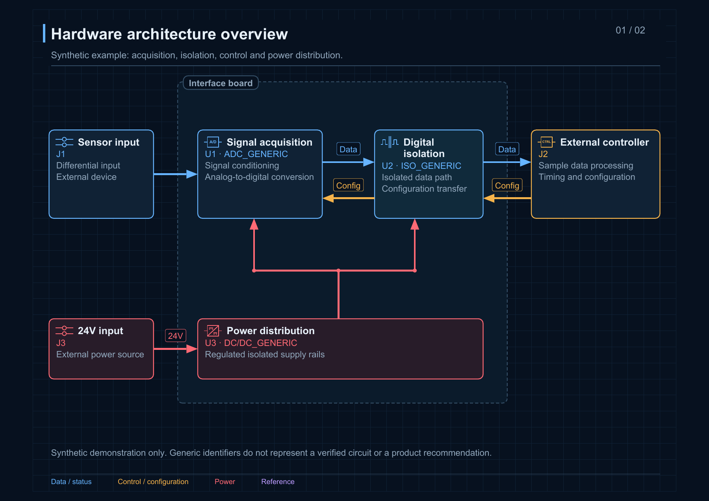
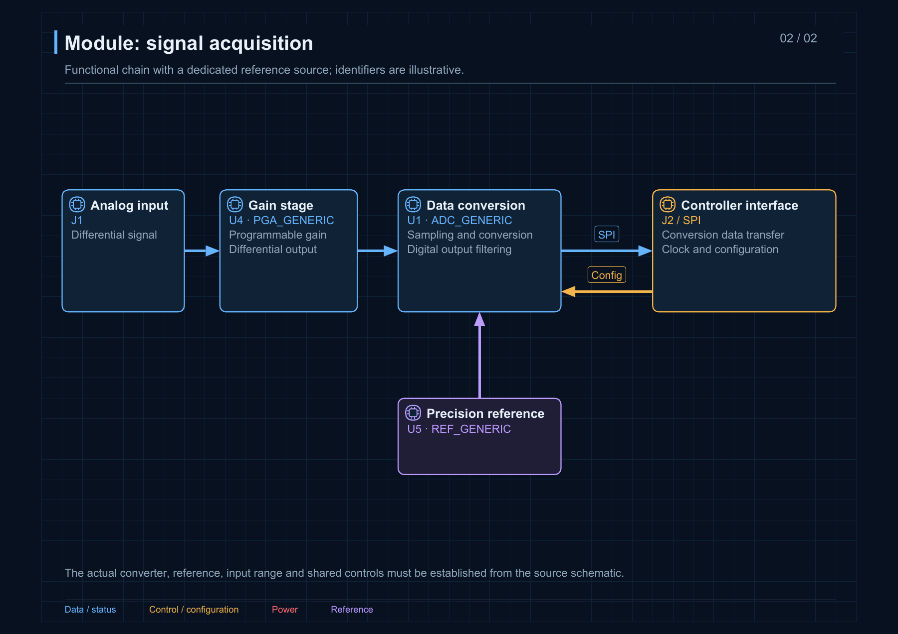
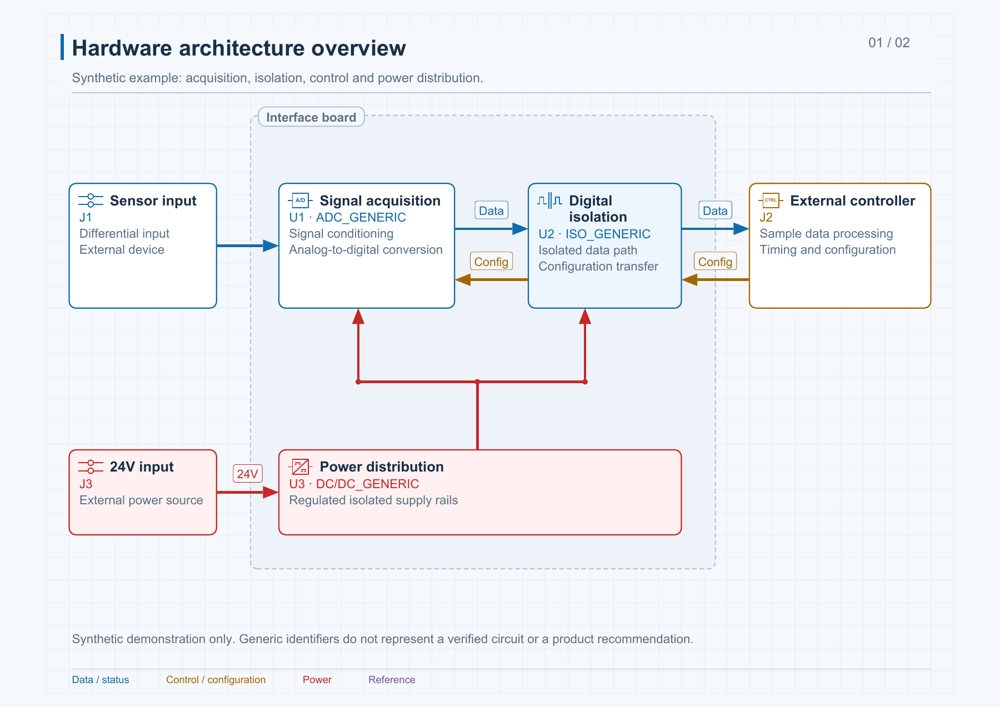

<h1 align="center">Schematic to Blocks</h1>

<h3 align="center">From electronic schematics to explorable hardware architecture.</h3>

<p align="center">Start with the system. Open each module. Follow signals, power and control to understand device models, operating principles and circuit roles.</p>

<p align="center">
  <a href="#quick-start"><strong>Quick start</strong></a> ·
  <a href="#explore-and-export"><strong>Explore and export</strong></a> ·
  <a href="#supported-sources"><strong>Supported sources</strong></a> ·
  <a href="README.md"><strong>中文</strong></a>
</p>

<p align="center">
  <a href="https://github.com/zoujinlin/schematic-to-blocks/actions/workflows/check.yml"></a>
  <a href="LICENSE"></a>
  
  
</p>

<p align="center"><a href="examples/acquisition.en.html"></a></p>

## Install, then describe the circuit

```sh
npx skills add zoujinlin/schematic-to-blocks -g --skill schematic-hardware-diagrams
```

Give your agent a schematic and the scope you want to understand:

> Use $schematic-hardware-diagrams to analyze board.pdf and help me understand the project. Start with a hardware overview, then draw each module. Explain key device models, operating principles and roles, and flag unresolved connections.

Continue with a focused revision:

> Expand the acquisition module's gain, reference and clock paths. Keep the other modules in place. Use red for power and add each interface's direction and net names.

Works with Codex and agents that load `SKILL.md`. Explanations follow the request language; device models, reference designators, pins, nets and numeric specifications stay intact.

## Start with the system. Inspect the devices.

| Understand the boundaries | Open the modules |
|---|---|
| See external equipment, the controller, main signal chains and power domains. | Separate conditioning, conversion, isolation, drivers, interfaces and references. |
| **Inspect device roles** | **Check the evidence** |
| Select a block for its model, operating principle, interfaces and supply details. | Read page/region, symbol or net locators and the source-file hash. |

<p align="center"></p>

Data, control, power and reference use distinct colors. Power is red; legend text matches each connection category. Solid arrow tips meet the block borders.

Module identifiers follow the actual circuit function. Gain stages use amplifier triangles; op amps include non-inverting/inverting inputs. ADCs and DACs use A/D and D/A notation, digital isolators show an isolation barrier, DC/DC stages show DC conversion, and connectors use contact symbols. References and controllers use REF and CTRL functional notation.

Select symbols from schematic and device evidence. Symbol identities stay consistent across languages and themes. HTML, SVG, PDF and draw.io share vector geometry; draw.io symbols move with their parent module and support shape editing. Unresolved functions or unavailable symbols retain clear text captions. Actual references, pins, channel directions and isolation ratings remain evidence-based. [Selection rules and full symbol list](skills/schematic-hardware-diagrams/references/electrical-symbols.md).

## Explore and export

One authored diagram, two themes. Pan, zoom, focus and trace relationships locally.

| Dark | Light |
|---|---|
|  |  |

- **Follow connections:** select a block for its direct, upstream or downstream authored relationships. Select an edge to inspect its endpoints and evidence.
- **Find a device:** choose any module from the persistent selector, or use the scrollable tabs on wide screens. The selected tab stays in view. Header controls wrap, and narrow screens place search and device details below the canvas; no page zoom adjustment is needed.
- **Present the diagram:** switch presentation mode and connection motion; reduced-motion preferences are respected.
- **Export the result:** download the complete current-theme SVG/PNG or print the current page. The CLI also produces multipage PDF, draw.io and page images.
- **Keep editing:** retain the JSON source and stable node identifiers for targeted revisions.

[Download English HTML](https://github.com/zoujinlin/schematic-to-blocks/raw/refs/heads/main/examples/acquisition.en.html) · [下载中文 HTML](https://github.com/zoujinlin/schematic-to-blocks/raw/refs/heads/main/examples/acquisition.zh-Hans.html) · [Example source](skills/schematic-hardware-diagrams/assets/example.en.json)

Open the downloaded HTML directly. Viewing needs no installation or online service. The acquisition examples are synthetic; generic identifiers are not actual device selections.

## Quick start

### 1. Install the skill

Use the command above, or copy `skills/schematic-hardware-diagrams` into `~/.codex/skills/`.

<details>
<summary>Runtime and dependencies</summary>

Python 3.10+, ReportLab, pdfplumber, pypdf and Pillow are required. Reuse an existing agent runtime where available. From the source repository root:

```sh
python -m pip install -r skills/schematic-hardware-diagrams/requirements.txt
python skills/schematic-hardware-diagrams/scripts/schematic.py doctor --json
```

Poppler renders source PDFs and static PNG outputs. Optional OCR uses local Tesseract or Tesseract.js and language data. KiCad CLI can supply a native XML netlist. Explicit tool paths are supported. [Formats and OCR](skills/schematic-hardware-diagrams/references/formats.md).

</details>

### 2. Analyze the schematic

Provide the file and the behavior you need explained. The agent reconciles components, wires, netlists and manufacturer documentation before authoring overview and module views. For proprietary formats, export PDF from the original EDA application and add a netlist when necessary.

Try a built-in example:

```sh
python skills/schematic-hardware-diagrams/scripts/schematic.py demo output/demo --locale en --theme dark
```

### 3. Validate and deliver

```sh
python skills/schematic-hardware-diagrams/scripts/schematic.py validate work/diagram.json --formats html,svg,pdf,drawio --json
python skills/schematic-hardware-diagrams/scripts/schematic.py deliver work/diagram.json --out output/board --formats html,svg,pdf,drawio,png --theme light --json
```

Open the returned `entrypoint`. Delivery publishes a complete release before updating `latest.json`; failures preserve the previous entry. Use absolute script paths after installation. [Diagram schema](skills/schematic-hardware-diagrams/references/diagram-spec.md) · [Delivery and repair](skills/schematic-hardware-diagrams/references/delivery.md).

## Supported sources

| Input | Evidence coverage |
|---|---|
| PDF, scanned PDF | Text/positions, page rendering and optional offline OCR |
| PNG/JPEG/TIFF/BMP/WebP | Images, image frames and optional OCR |
| KiCad 6+ `.kicad_sch` | Components, wires, labels, child-sheet references; optional native CLI XML netlist |
| Legacy KiCad `.sch` | Component inventory; original-application PDF/netlist export |
| EAGLE XML `.sch` | Parts, sheets and explicit gate/pin net members; hierarchy requires flattened export |
| EasyEDA Std JSON | Components, wires and labels in single/multi-sheet source containers |
| KiCad XML netlist | Explicit components and net pin members |
| Altium, OrCAD, EasyEDA Pro and proprietary binaries | Analyze original-application PDF/netlist exports |

Inventory and geometry do not constitute complete net solving. Pin transforms, hierarchy and bus membership need native netlists or visual confirmation. OCR stays marked as candidate evidence. [Full format boundaries](skills/schematic-hardware-diagrams/references/formats.md).

## How it works

| Stage | Result |
|---|---|
| Extract evidence | Source SHA256, component inventory and page/symbol/net locators |
| Analyze circuits | Separate schematic facts, manufacturer documentation, inference and open questions |
| Author diagram data | JSON nodes, electrical symbols, interfaces, supplies, evidence and layout |
| Validate | Endpoints, device crossings, junctions, overflow, labels and glyphs |
| Deliver and inspect | Standalone HTML and requested formats, followed by visual review |

Semantic SVG layers share theme tokens across the viewer and exports. Interactions use authored nodes and connections; zoom and focus do not restrict export scope. Motion aids reading and does not establish timing, fault propagation or safety. The agent makes engineering judgments from source evidence.

See [localization and font rules](skills/schematic-hardware-diagrams/references/languages.md) for other languages and complex-script exports.

## Development

```sh
npm ci --ignore-scripts
python -m unittest discover -s skills/schematic-hardware-diagrams/tests -v
npx playwright install --with-deps chromium
npm run test:layout
```

Node.js, the DOM parser and Playwright are development-only. Generated HTML requires no external JavaScript or CSS. Tests cover format extraction, evidence, language, function-specific symbols across export formats, geometry, themes, zoom, pan, focus, full-graph export and failed-delivery recovery. Browser layout tests use 13 modules with long titles at viewport widths from 320 to 1920 px, checking navigation, search, details and the export menu, and saving dark/light screenshots. Automated checks still require visual and electrical review.

## License

[MIT](LICENSE). Schematics, datasheets, fonts and OCR models retain their respective licenses.
