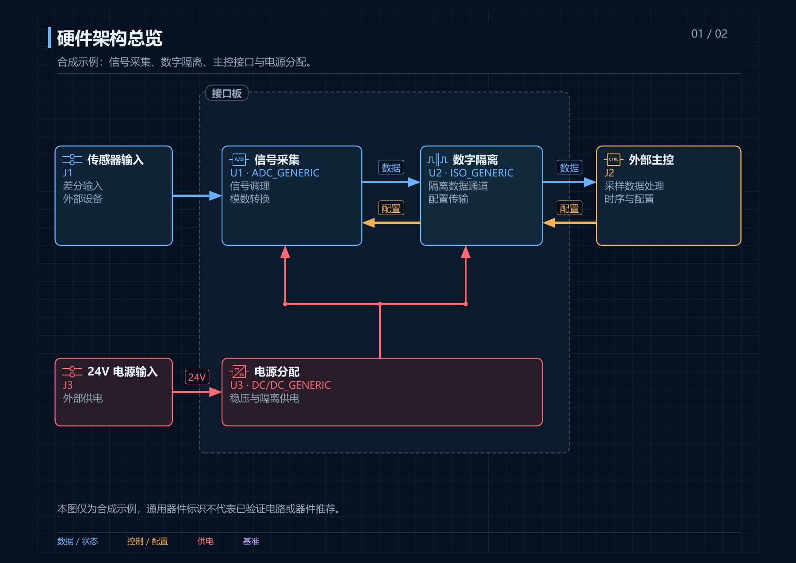
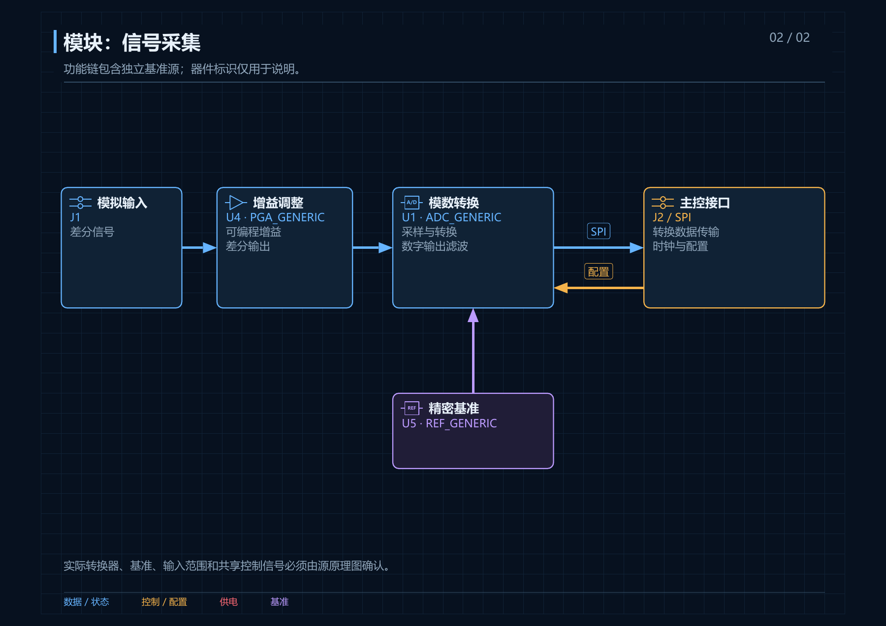
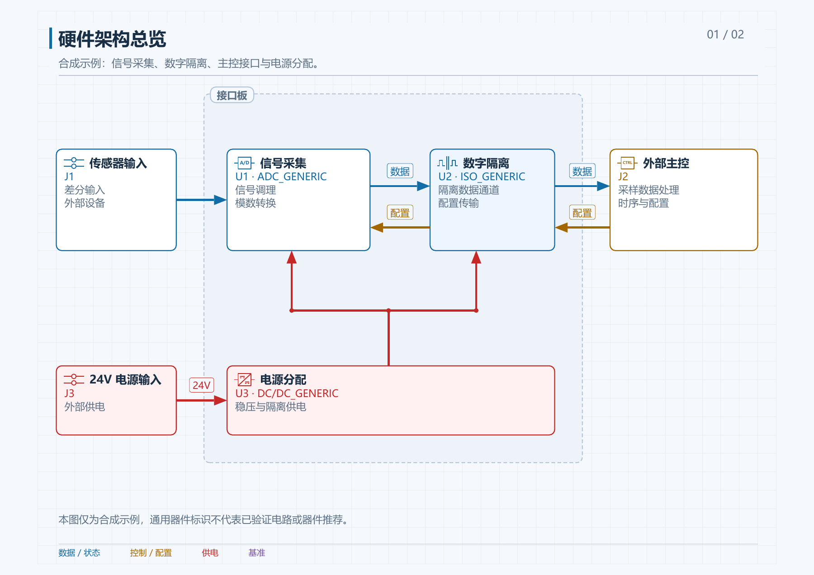

<h1 align="center">Schematic to Blocks</h1>

<h3 align="center">将电子原理图转换为可交互的硬件架构图。</h3>

<p align="center">先看系统总览，再展开功能模块。沿信号、电源和控制路径，理解器件型号、工作原理与承担功能。</p>

<p align="center">
  <a href="#快速开始"><strong>快速开始</strong></a> ·
  <a href="#查看与导出"><strong>查看与导出</strong></a> ·
  <a href="#支持哪些原理图"><strong>支持格式</strong></a> ·
  <a href="README.en.md"><strong>English</strong></a>
</p>

<p align="center">
  <a href="https://github.com/zoujinlin/schematic-to-blocks/actions/workflows/check.yml"></a>
  <a href="LICENSE"></a>
  
  
</p>

<p align="center"><a href="examples/acquisition.zh-Hans.html"></a></p>

## 安装，然后描述需要理解的电路

```sh
npx skills add zoujinlin/schematic-to-blocks -g --skill schematic-hardware-diagrams
```

将原理图放入项目目录，对 Agent 说明需求：

> 使用 $schematic-hardware-diagrams 分析 board.pdf，帮助我快速熟悉项目。先画硬件架构总览，再按模块绘制框图，说明关键器件的型号、工作原理和功能，并标出待确认的连接。

继续修改时可以直接说：

> 展开采集模块中的增益、基准和时钟路径，保留其他模块的布局。电源使用红色，补充每条接口的方向和网络名称。

支持 Codex，以及能够加载 `SKILL.md` 的 Agent。输出语言跟随提示词；型号、位号、引脚、网络名称和数值保持原样。

## 从系统总览到器件细节

| 看清系统边界 | 展开功能模块 |
|---|---|
| 显示外部设备、主控、主要信号链和供电分区。 | 分解输入调理、转换、隔离、驱动、接口与基准等电路。 |
| **查看器件职责** | **核对连接依据** |
| 选择功能块，查看型号、工作原理、接口和供电说明。 | 查看原理图页码／区域、符号或网络定位及源文件摘要。 |

<p align="center"></p>

数据、控制、电源和基准采用不同颜色。电源为红色，图例文字与线路颜色一致；实心箭头尖端直接连接功能块边界。

模块标识按实际电路功能选取。放大级使用增益三角形，运放标出正、反相输入；ADC／DAC 使用 A/D、D/A 转换标识；数字隔离使用隔离屏障，DC/DC 使用直流变换标识，连接器使用接点符号。基准与控制器采用 REF、CTRL 功能标识。

符号由原理图和器件资料确定，随语言和主题保持一致。HTML、SVG、PDF 与 draw.io 共用矢量定义；draw.io 中符号随模块移动，并可编辑形状。未确认功能或缺少适用符号时保留文字说明。具体位号、引脚、通道方向和隔离等级仍以电路证据为准。[符号选用规则与完整列表](skills/schematic-hardware-diagrams/references/electrical-symbols.md)。

## 查看与导出

同一份图形数据可切换深浅主题。平移、缩放、聚焦与连接追踪均在本地执行。

| 深色 | 浅色 |
|---|---|
|  |  |

- **查看路径**：选择功能块，查看直接相连、上游或下游的已记录连接；也可选择连线核对接口和证据。
- **浏览模块**：使用模块导航或搜索定位器件、型号和网络。
- **演示与动效**：切换演示视图和连接动效；遵循系统的减少动态效果设置。
- **导出结果**：HTML 内可导出当前主题的完整 SVG／PNG，或打印当前页；命令行可生成多页 PDF、draw.io 和逐页图像。
- **继续编辑**：保留 JSON 图形源文件，用相同节点标识进行后续修改。

[下载中文 HTML](https://github.com/zoujinlin/schematic-to-blocks/raw/refs/heads/main/examples/acquisition.zh-Hans.html) · [Download English HTML](https://github.com/zoujinlin/schematic-to-blocks/raw/refs/heads/main/examples/acquisition.en.html) · [查看示例数据](skills/schematic-hardware-diagrams/assets/example.zh-Hans.json)

下载后可直接打开 HTML，无需查看器安装，也无需在线服务。示例是合成采集电路，通用器件标识不代表实际选型。

## 快速开始

### 1. 安装技能

使用上面的安装命令，或将仓库中的 `skills/schematic-hardware-diagrams` 目录复制到 `~/.codex/skills/`。

<details>
<summary>运行环境与依赖</summary>

需要 Python 3.10+、ReportLab、pdfplumber、pypdf 和 Pillow。可复用 Agent 已有的运行时。以下命令从源码仓库根目录运行：

```sh
python -m pip install -r skills/schematic-hardware-diagrams/requirements.txt
python skills/schematic-hardware-diagrams/scripts/schematic.py doctor --json
```

Poppler 用于原理图 PDF 渲染和静态 PNG 导出。OCR 按需使用本地 Tesseract 或 Tesseract.js 及语言模型；KiCad CLI 可补充原生网表。可通过参数指定工具路径。[依赖与 OCR 说明](skills/schematic-hardware-diagrams/references/formats.md)。

</details>

### 2. 分析原理图

提供文件和需要理解的范围。Agent 核对器件、导线、网表与数据手册，建立总览和模块视图。对于专有格式，先在原软件导出 PDF，必要时补充网表。

只想查看效果，可运行内置样例：

```sh
python skills/schematic-hardware-diagrams/scripts/schematic.py demo output/demo --locale zh-Hans --theme dark
```

### 3. 检查并交付

```sh
python skills/schematic-hardware-diagrams/scripts/schematic.py validate work/diagram.json --formats html,svg,pdf,drawio --json
python skills/schematic-hardware-diagrams/scripts/schematic.py deliver work/diagram.json --out output/board --formats html,svg,pdf,drawio,png --theme light --json
```

打开返回的 `entrypoint`。每次交付生成完整版本，通过后才更新 `latest.json`；失败时保留上一次入口。安装后的脚本使用其绝对路径调用。[图形规范](skills/schematic-hardware-diagrams/references/diagram-spec.md) · [交付与修复](skills/schematic-hardware-diagrams/references/delivery.md)。

## 支持哪些原理图

| 输入 | 读取范围 |
|---|---|
| PDF、扫描 PDF | 文字与坐标、页面渲染、可选离线 OCR |
| PNG／JPEG／TIFF／BMP／WebP | 图像证据、图像帧及可选 OCR |
| KiCad 6+ `.kicad_sch` | 器件、导线、标签和子图引用；可调用 KiCad CLI 导出 XML 网表 |
| 旧版 KiCad `.sch` | 器件清单；结合原软件导出的 PDF／网表 |
| EAGLE XML `.sch` | 器件、图页和明确的 gate/pin 网络成员；层次模块需展开导出 |
| EasyEDA 标准版 JSON | 单图／多图源数据中的器件属性、导线和标签 |
| KiCad XML 网表 | 器件及网络引脚成员 |
| Altium、OrCAD、EasyEDA Pro 等专有格式 | 在原软件导出 PDF／网表后分析 |

器件和几何信息不等于完整的网络求解。KiCad／EasyEDA 的引脚变换、层次网络和总线需要原生网表或图面核对；OCR 结果保留为待核对项。[完整格式边界](skills/schematic-hardware-diagrams/references/formats.md)。

## 工作方式

| 阶段 | 结果 |
|---|---|
| 提取证据 | 记录源文件 SHA256、器件、图页／符号／网络定位 |
| 分析电路 | 区分原理图事实、数据手册依据、工程推断与待确认项 |
| 编写图形数据 | 用 JSON 描述功能块、电气符号、接口、供电、证据和布局 |
| 校验图形 | 检查端点、穿框、分支、文字溢出、标签避让和字形 |
| 交付与复核 | 发布独立 HTML 及所需格式，再检查实际图面 |

图形由 SVG 图层和共享主题标记生成。交互层只操作已记录的节点与连接；缩放和聚焦不改变导出范围。动效用于辅助阅读，不表示实际时序、故障传播或安全验证。电路判断由 Agent 结合原始证据完成。

多语言说明、字体与复杂文字导出见[语言规则](skills/schematic-hardware-diagrams/references/languages.md)。

## 开发与验证

```sh
npm ci --ignore-scripts
python -m unittest discover -s skills/schematic-hardware-diagrams/tests -v
```

Node.js 和 DOM 解析库仅用于开发测试，生成的 HTML 没有外部 JavaScript／CSS 依赖。测试覆盖格式读取、证据、语言、功能符号选择与跨格式导出、连接几何、主题、缩放、平移、聚焦、完整图形导出和失败恢复。通过自动校验后仍需检查图面与电气依据。

## 许可

[MIT](LICENSE)。原理图、数据手册、字体和 OCR 模型适用各自许可。
